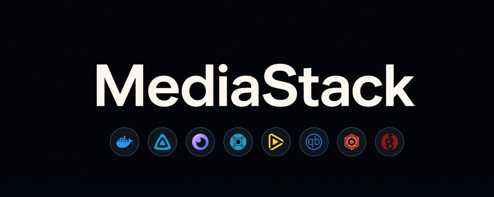
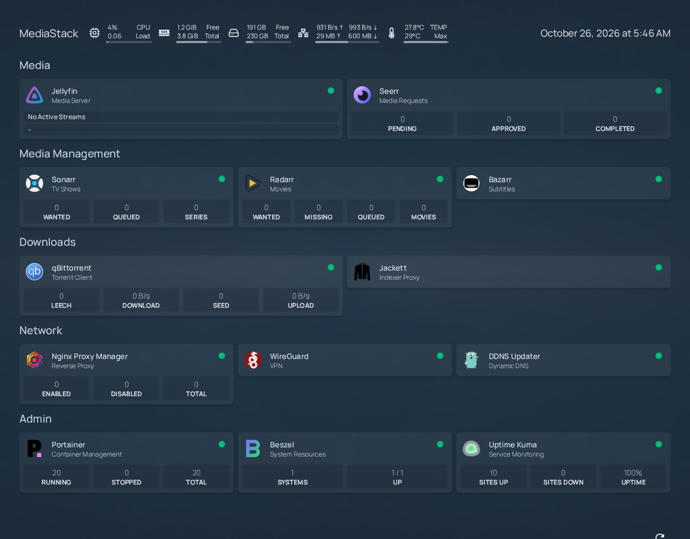
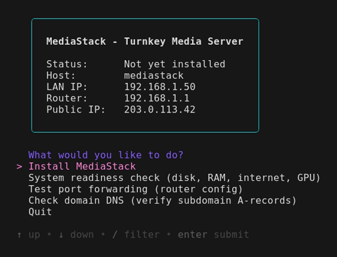

A complete home media server, from guided installation to everyday management.

[](https://www.debian.org) [](https://docs.docker.com/compose/) [](https://github.com/famesjranko/MediaStack/actions/workflows/ci.yml) [](#license)

MediaStack brings Jellyfin, Seerr, Sonarr, Radarr and qBittorrent together for streaming, media requests, library management and downloads. It installs and connects the services, with a Homepage dashboard, Portainer for container management, and Uptime Kuma and Beszel for service and system monitoring.

Guided setup configures accounts, local or NAS storage, and media quality settings. Optional features include hardware transcoding, automatic subtitles with Bazarr, and SMB file sharing. Recommended security settings add a firewall, restricted access to admin pages, automatic security updates and kernel hardening.

Optional remote access makes Jellyfin and Seerr available over HTTPS, with Let's Encrypt certificate management through Nginx Proxy Manager, dynamic DNS updates and fail2ban protection against repeated login failures. A WireGuard VPN provides private access to the server or home network, with access controls for each device.

After installation, the same `./mediastack` menu manages services, updates, settings and GPU configuration. It also provides fail2ban ban management, certificate and security checks, storage status and network diagnostics.

**Homepage dashboard**<br>
Open services and see their status.



**Installation menu**<br>
Start guided setup and check the server's readiness.



**Management menu (day 2)**<br>
Manage the installed stack, updates and security.


## Quick Start

Run these commands from your normal user account with sudo access.

```bash
git clone https://github.com/famesjranko/MediaStack.git MediaStack
cd MediaStack
./mediastack
```

Choose **Install MediaStack** and follow the guided setup. It sets up storage, applies your security choices, and starts and connects the services. Once the core stack is ready, setup offers hardware transcoding if you have a supported GPU, then remote access. You can skip either and add it later.

At the end, open the Homepage address shown by the installer to reach your services. Run `./mediastack` again whenever you want to manage the stack. It now opens the day-2 menu for updates, settings and health checks.

> [!TIP]
> Run `./mediastack` and choose **Get enhanced menus** to install [gum](https://github.com/charmbracelet/gum) for arrow-key menus instead of numbered lists.

## Requirements

- Debian 12 or 13 Server (headless)
- Git and sudo installed
- 50 GB or more of free disk
- A machine that stays on, such as a small server or mini PC
- An internet connection

## What you get

- Up to 20 containers, depending on the features you enable. Installed services restart after a reboot unless you stopped them.
- Jellyfin for playback, Seerr for requests, Sonarr for TV, Radarr for movies and qBittorrent for downloads, already connected to each other.
- A Homepage dashboard, Uptime Kuma and Beszel for monitoring, Portainer for containers and optional Bazarr for subtitles.
- Optional remote access over HTTPS with a domain, plus a WireGuard VPN.
- Hardware transcoding on NVIDIA, AMD and Intel GPUs.
- A [TRaSH Guides](https://trash-guides.info/) folder layout for downloads and media.
- Safe re-runs: the installer skips what is configured and warns when something has drifted.
- One menu for day 2: updates, settings, health checks, fail2ban, GPU changes and diagnostics all live in `./mediastack`.
- Uninstall removes MediaStack's containers and owned configuration. Media stays at your configured data path; Docker stays installed. Edited host files can require manual cleanup.

> [!NOTE]
> No public trackers are enabled. Add indexers only where you have the legal right to use them.

## Documentation

- [Install guide](docs/guide/install.md): requirements and setup choices.
- [Using the menu](docs/guide/using-the-menu.md): manage an installed stack.
- [Remote access](docs/guide/remote-access.md): domain, router and VPN setup.
- [Troubleshooting](docs/guide/troubleshooting.md): help when something fails.

The [full documentation index](docs/README.md) includes technical references. See [Contributing](CONTRIBUTING.md) for development work.

<!-- stable-image-badges:start -->
[](docs/guide/using-the-menu.md)
<!-- stable-image-badges:end -->

### Direct CLI Usage

The menu covers a normal install, and the scripts behind it stay available for automation: see [Direct CLI usage](docs/guide/using-the-menu.md#direct-cli-usage).

## License

MediaStack is source-available under the [PolyForm Noncommercial License 1.0.0](LICENSE).

Non-commercial use is permitted. Commercial use requires prior written permission from the licensor.

SPDX-License-Identifier: PolyForm-Noncommercial-1.0.0
