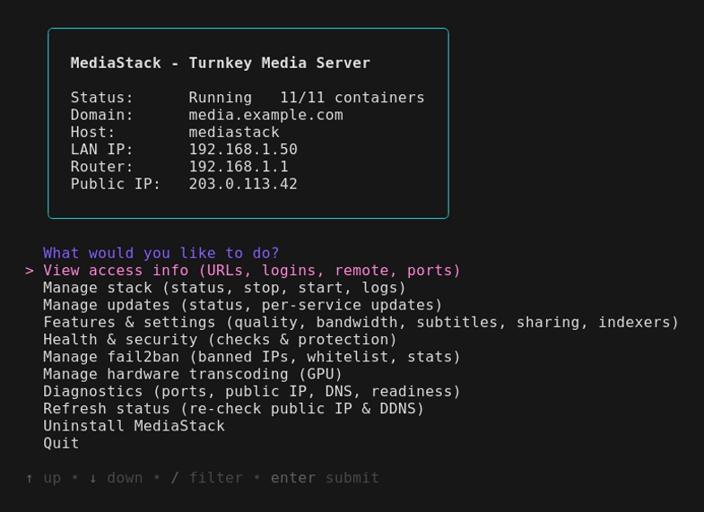

# Use the MediaStack menu

This guide is for people who run MediaStack at home and manage it after install.

## Open the menu

1. Log in to the MediaStack machine. Do not use `root`. The menu refuses to run as root.
2. Go to the MediaStack folder.
3. Run `./mediastack`.

The menu uses arrow keys when `gum` is installed. Otherwise it shows a numbered list. Install `gum` with **Get enhanced menus (install GUM)**.

Before you install, the menu has these items:

| Menu item | What it does |
|:----------|:-------------|
| Install MediaStack | Runs the installer |
| System readiness check (disk, RAM, internet, GPU) | Checks the machine. Changes nothing |
| Test port forwarding (router config) | Checks that your router ports reach this machine |
| Check domain DNS (verify subdomain A-records) | Checks that your subdomains point to your IP address |
| Get enhanced menus (install GUM) | Installs GUM for nicer menus. Shows only when GUM is missing |
| Uninstall MediaStack | Removes MediaStack. Shows only after a partial install, when a `.env` file exists |

After install, the same command opens the day-2 menu. It shows a status header over the items in the next sections.



The screenshot can lag behind the menu. The text in this guide is correct.

Some items show only when they apply:

- **View storage & data mount** shows on NAS installs only.
- **Add remote access** shows only before remote access is set up.
- **Update DDNS provider / credentials** shows only when remote access uses DDNS.
- The NVIDIA driver and **Unlock** items show only on an NVIDIA Unlock install.

To leave any submenu, pick **Back**. To leave the menu, pick **Quit**.

## View access info

Menu item: **View access info (URLs, logins, remote, ports)**.

1. Pick **View access info**.
2. Read the service addresses, logins, and ports.
3. To see the admin password, answer yes to the reveal question. The default is no.

The admin password is your one login for every service.

## View storage & data mount

Menu item: **View storage & data mount (NAS source, mount health, watchdog)**. It shows on NAS installs only.

The screen shows the NAS source, the mount state, free space, the watchdog state, and how many services run.

1. Pick **View storage & data mount**.
2. Read the mount state.
3. To test the mount again, pick **Re-check NAS now**.

A running watchdog repairs the mount and restarts paused services by itself. It does not restart a service you stopped with **Stop a service** or **Stop all services**. To turn the watchdog on or off, use **Features & settings** > **NAS storage watchdog**.

## Manage stack

Menu item: **Manage stack (status, stop, start, logs)**. The box at the top shows service status, the data folder, and free space.

| Item | What it does |
|:-----|:-------------|
| Stop a service | Stops one service |
| Start a service | Starts one service |
| Stop all services | Stops the whole stack |
| Start all services | Starts the whole stack |
| Tail logs (live) | Shows live logs for all enabled services |

Use these items instead of raw `docker compose` commands. They start the right optional services. On NAS installs they also tell the NAS watchdog which services you stopped, so it leaves them stopped; **Start a service** and **Start all services** clear that. **Start a service** also starts the services it depends on, and the watchdog then forgets that you stopped them. Stops made with raw `docker` commands are not tracked.

To read logs, pick **Tail logs (live)**. It streams logs for all enabled services. Press `Ctrl+C` to return to the menu. To follow one service, use `docker compose logs -f <service>`. Docker keeps up to 3 files of 10 MB for each service. DDNS Updater is the exception: it keeps 2 files of 1 MB.

After a reboot, installed services restart automatically. Docker normally leaves manually stopped containers stopped; the NAS watchdog restarts missing NAS-dependent services after its startup check, except the ones you stopped from this menu. Optional services run only when enabled. See [After a reboot](troubleshooting.md#after-a-reboot).

## Manage updates

Menu item: **Manage updates (status, per-service updates)**. This is the update path for a normal install. Nothing updates by itself.

The screen lists each service with one status:

| Status | Meaning |
|:-------|:--------|
| Up to date | The newest image for its tag is running |
| Update available | A newer image exists |
| Not installed | No container exists for this service |
| Unknown local digest | The running image cannot be compared (built or imported locally) |
| Unknown (offline) | The registry cannot be reached |

A new Stable install shows many services as **Update available**. This is normal. You choose when to update.

To update one service:

1. Pick **Update a service**.
2. Pick the service.
3. Wait for the check that follows the update.

To update every service, pick **Update all**. **Update all** skips stopped services and WireGuard. Updating WireGuard restarts remote access, so update it alone from your home network with **Update a service**. WireGuard asks for a second confirmation.

An update recreates only a service that is running. For a stopped service, it downloads the image without recreating the container. **Start all services** applies the downloaded image. **Start a service** starts the existing container with its old image.

Before an update moves a service off its installed image, MediaStack attempts to save a restore point of its settings. It skips configurations larger than 256 MiB and reports archive failures. The update can continue without a restore point.

To go back to the installed image:

1. Pick **Revert a service to its installed image**.
2. Pick the service. The list shows only services you updated.
3. Read the result. Revert checks that the service is healthy and that MediaStack can still log in to qBittorrent, Sonarr, Radarr, and Jellyfin.

If the check fails, Revert says so and keeps the restore point. If no restore point exists, Revert warns that the settings may be newer than the image. It then asks you to confirm.

To scan again, pick **Re-check for updates now**.

### Stable and latest images

The installer asks which image versions to install with. This choice applies at install time only.

| Channel | Default | Installs |
|:--------|:--------|:---------|
| Stable | Yes | The image versions MediaStack tested |
| Latest | No | The newest upstream tags |

The fresh-install wizard selects the channel. An ordinary installer re-run does not offer a channel switch. For an existing install, use **Manage updates** to update services or revert them to their installed images. Old image layers stay on disk until you prune them (see [Direct CLI usage](#direct-cli-usage)).

### Update MediaStack itself

1. Get the new MediaStack files into the MediaStack folder, for example with `git pull`.
2. Run `./mediastack`.
3. Pick **Health & security** > **Apply changes from a MediaStack update**.

Do this once after each MediaStack update. A finished install does not re-run setup by itself. This action applies the host and service changes of the new release. It changes only MediaStack's own items. It does not touch your choices for the firewall, quality, DDNS, or features.

Portainer shows update indicators. Use it to look, read logs, and restart. Use **Manage updates** to update.

## Features & settings

Menu item: **Features & settings (quality, bandwidth, subtitles, sharing, indexers)**.

| Item | What it does |
|:-----|:-------------|
| Add remote access (HTTPS, domain, WireGuard) | Sets up remote access. See the [remote access guide](remote-access.md) |
| Subtitles (Bazarr) | Turns subtitles on or off |
| File sharing (SMB) | Turns the LAN file share on or off |
| Search indexers | ON adds the example public indexers. OFF stops configuring them; existing indexers remain active until you disable or remove them in Jackett, Sonarr and Radarr |
| Firewall (UFW) | Turns the MediaStack firewall rules on or off |
| Admin-port filter | Limits admin pages to your home network and Tailscale |
| System hardening | Turns security upgrades and kernel hardening on or off |
| NAS storage watchdog | Turns NAS mount repair on or off (NAS installs only) |
| Change quality profile | Picks a new resolution and size |
| Adjust bandwidth | Sets qBittorrent download and upload limits |
| Update DDNS provider / credentials | Changes the DDNS provider or its login |

### Change the quality profile

1. Make sure Sonarr and Radarr both run.
2. Pick **Change quality profile**.
3. Pick the resolution, then the size.
4. Confirm. The default is no.

The new profile changes which releases qualify as upgrades. MediaStack does not start a library search when it changes the profile. Start a manual search in Sonarr or Radarr if you want to search existing media immediately. Upgrades can use more downloads and disk space. The menu renames the profile in place, so no extra profile remains. Do not rename the profile by hand in `config.yml`.

### Adjust bandwidth

1. Pick **Adjust bandwidth**.
2. Enter the download limit in MB/s. Enter `0` for no limit.
3. Enter the upload limit.

The limits apply at once. MediaStack saves them after the live change works.

### Share files on your LAN

1. Pick **File sharing (SMB)**.
2. Choose what the share shows.
3. Connect from another device.

| Share | Shows | Use for |
|:------|:------|:--------|
| `Media` | The data folder | Browse and manage media |
| `MediaStackSystem` | The whole file system | Advanced use only |

- Windows: `\\<server-ip>\Media`
- macOS and Linux: `smb://<server-ip>/Media`

Use the admin username and password. The share is for your home network only. Turning SMB off removes MediaStack's share and firewall rules. It stops Samba only when MediaStack installed it.

### Firewall, admin-port filter, and hardening

Each item is an ON or OFF toggle.

- **Firewall (UFW)**: OFF removes only MediaStack's rules. It keeps an SSH allow rule so you cannot lock yourself out. If you added your own rules, UFW stays active.
- **Admin-port filter**: OFF asks first. Admin pages then answer any address your router forwards.
- **System hardening**: OFF reverts the security upgrades and kernel settings that MediaStack set.

### Update DDNS provider / credentials

Use this item to enter new DDNS credentials or to change between Cloudflare and Porkbun on the same domain.

1. Pick **Update DDNS provider / credentials**.
2. Pick the provider. **Skip for now** changes nothing.
3. Enter the credentials. MediaStack checks them in a throwaway container first.
4. Confirm the restart of `ddns-updater`. The default is no.

If the new setup fails to start, MediaStack restores the old one. A free-hostname provider (DuckDNS, Dynu, deSEC, dynv6) needs a new hostname. This changes your domain names. For that case the menu offers **Add remote access** instead. The DDNS web page on port 8000 shows status only.

## Health & security

Menu item: **Health & security (checks & protection)**.

| Item | What it checks |
|:-----|:---------------|
| Run all checks | Every check below |
| fail2ban protection (regex + jails) | The fail2ban rules and jails |
| TLS certificate expiry | When your HTTPS certificates end |
| DNS / public-IP drift | Whether your domain still points to your IP |
| Disk space | Free space |
| Firewall (UFW + Docker port lock) | The firewall and the admin-port filter |
| Apply changes from a MediaStack update | Applies host changes of a new release (see [Update MediaStack itself](#update-mediastack-itself)) |

If the main menu shows "Admin-port filter NOT active", pick **Apply changes from a MediaStack update**.

## Manage fail2ban

Menu item: **Manage fail2ban (banned IPs, whitelist, stats)**.

| Item | What it does |
|:-----|:-------------|
| Banned IPs | Lists banned addresses |
| Whitelist (always-allow IPs) | Lists addresses that fail2ban never bans |
| Jail stats & history | Shows ban counts and the recent ban log |

To release a banned address:

1. Pick **Banned IPs**.
2. Pick the address.
3. Pick **Unban (restores all access)**. To also stop future bans of it, pick **Unban + always allow (won't be banned again)**.

With more than one banned address, **Unban all** releases all of them.

To add or remove your own whitelist entries, pick **Whitelist (always-allow IPs)**, then **Add an IP** or a **Remove** entry. The four private-network defaults stay locked.

A ban blocks every MediaStack service, not only the one that triggered it, and one unban clears it everywhere.

fail2ban runs only on installs with a real domain. A LAN-only install shows "not installed (LAN-only install)". If a domain is set and fail2ban is stopped, start it with **Manage stack** > **Start a service**.

## Manage hardware transcoding (GPU)

Menu item: **Manage hardware transcoding (GPU)**.

| Item | What it does |
|:-----|:-------------|
| Configure or change hardware transcoding | Detects the GPU again and applies the hardware setup |
| Update NVIDIA driver + reapply Unlock patch | Updates the driver, then patches it (Unlock mode only) |
| Reapply Unlock patch only | Patches the driver again (Unlock mode only) |
| Reboot to finish hardware transcoding | Shows when an NVIDIA step waits for a reboot |

| GPU | What setup does |
|:----|:----------------|
| NVIDIA Standard (recommended) | Debian driver and NVENC in Jellyfin. NVIDIA limits it to about 3 to 5 transcodes |
| NVIDIA Unlock (advanced) | Patched driver that removes the session limit. You must patch again after each driver update |
| AMD | Mesa VAAPI drivers |
| Intel | Intel media drivers with QSV, and VAAPI as fallback |
| None | Software transcoding |

Unlock changes driver files, and this may conflict with NVIDIA's terms. Standard installs get driver updates from `apt`, so they need no patch.

## Diagnostics

Menu item: **Diagnostics (ports, public IP, DNS, readiness)**.

| Item | What it does |
|:-----|:-------------|
| Test port forwarding | Opens a submenu. Pick **Test the required MediaStack ports** or **Test a specific port** |
| Check domain DNS | Compares your subdomains to your live public IP |
| System readiness check | Checks disk, RAM, internet, and GPU |
| Run speed test | Measures your connection speed |

If a remote test fails, see the [troubleshooting guide](troubleshooting.md).

## Refresh status

Menu item: **Refresh status (re-check public IP & DDNS)**.

The menu header caches your public IP for the session and checks DDNS whenever it redraws. Pick **Refresh status** to check your public IP again and redraw the header. Use it after you change DDNS provider, to watch the change take effect.

The `DDNS:` header line is green when the IP matches your public IP. It is yellow with `propagating?` when the IP differs.

## Uninstall MediaStack

Menu item: **Uninstall MediaStack**.

1. Pick **Uninstall MediaStack**.
2. Read what it will remove.
3. Type `DESTROY` to confirm.

Uninstall removes:

- The host changes MediaStack made: firewall rules, hardening files, Samba setup (only if MediaStack installed it), watchdog services, and login banners.
- The `config/` runtime state (the app databases and logins).
- `.env` and `config.yml`.
- MediaStack's Docker volumes and networks.

Uninstall keeps:

- Your media and downloads at the configured data path.
- `config/examples/`.
- The MediaStack folder.

Docker Engine stays installed. If host cleanup fails, Uninstall keeps `.env` so you can retry. It preserves and reports some edited host configuration files, but this protection does not cover every generated file. Back up changes before uninstalling.

## Direct CLI usage

A normal install never needs these commands. They are for power users and automation. The menu is the safe path.

| Command | Purpose |
|:--------|:--------|
| `./setup.sh` | Installs without the menu |
| `./setup.sh --full` | Also installs Docker on a bare Debian host |
| `./setup.sh --remote` | Adds or repairs remote access. Repair has no menu item |
| `./setup.sh --transcoding` | Checks hardware transcoding again |
| `./scripts/configure.sh [--only svc,...]` | Applies `config.yml` edits to the services |
| `./scripts/update.sh [--prune]` | Pulls and recreates images. `--prune` also deletes unused image layers |
| `docker compose ...` | Raw status, logs, restarts |

These raw commands show status and logs:

```bash
docker compose ps                        # service status
docker compose logs -f jellyfin          # follow logs
docker compose logs --since 1h jellyfin  # last hour
docker compose logs --tail 100 jellyfin  # last 100 lines
docker compose restart sonarr            # restart one service
```

A bare `docker compose up -d` starts only the default services. It does not start remote access, subtitles, or autoheal. Use **Manage stack** > **Start all services** instead.

### Edit config.yml and re-apply

1. Edit `config.yml`.
2. Run `./scripts/configure.sh`.

Re-runs add missing items and preserve many existing registrations. Some settings are reapplied from configuration, including qBittorrent preferences and Jellyfin's remote bitrate limit.

- A removed indexer stays registered. Delete it in the Jackett, Sonarr, and Radarr pages yourself.
- Editing `qbittorrent.max_ratio` and re-running configuration updates qBittorrent's ratio limit.
- Do not rename the quality profile here. Use **Change quality profile** in the menu.

### Add an indexer or a library

1. Open `config.yml`.
2. For an indexer, add `- id: <jackett-id>` and `type: <general|tv|movies>`. For a library, add an entry under `jellyfin.libraries`.
3. Run `./scripts/configure.sh`.

### Apply changes in `.env`

After you change a value in `.env` that the compose file uses, reopen `./mediastack` and choose **Manage stack** > **Start all services**. This includes the enabled optional profiles. Direct CLI users must include those profiles in `docker compose up -d`. After you change fail2ban jails or filters, run `docker compose restart fail2ban`.

## See also

[Install](install.md) · [Remote access](remote-access.md) · [Troubleshooting](troubleshooting.md)
